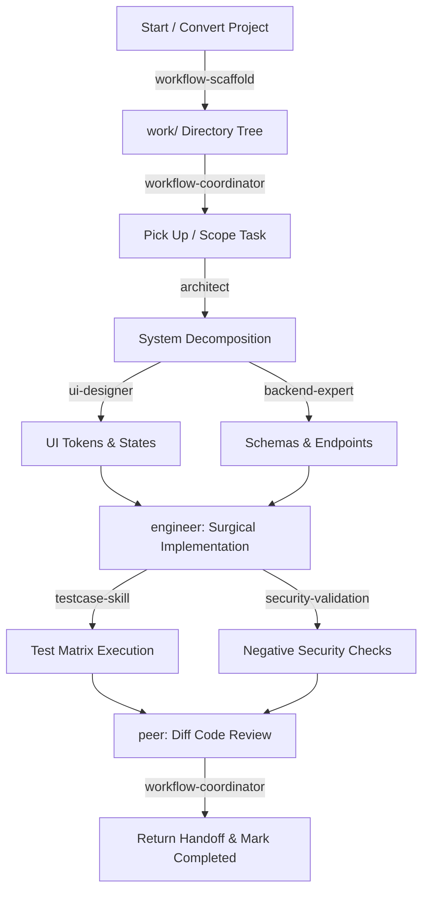

# Token-Lean Full-Stack AI Skills

A high-density, low-token AI skills suite for full-stack software development and project workflow coordination. Designed to deliver expert-level architecture, UI/UX, backend, engineering, security, testing, and multi-agent coordination without burning excessive tokens.

---

## Why Token-Lean? (Solving the `pstack` / `upskill` Problem)

Heavy agent frameworks and prompt stacks (like `pstack` and `upskill`) frequently blow through context windows because they:
1. **Dump monolithic system prompts** with verbose conversational preambles and meta-explanations.
2. **Eagerly load giant reference manuals** regardless of the specific task.
3. **Encourage multi-page ceremonial outputs** instead of actionable code diffs and decisions.

This suite solves that through **Progressive Disclosure & Zero-Fluff Directives**:
- **Tiny Discovery Footprint**: Frontmatter descriptions are kept under 25 words (~250 tokens total for the entire 10-skill suite).
- **Dense Imperative Instructions**: Each `SKILL.md` is strictly 200–350 words, focusing purely on decisions, constraints, and deliverables.
- **Reference Sharding**: Deep domain checklists (e.g., API security specs) live in standalone reference files loaded only when that domain is actively engaged.
- **Strict Output Budgets**: Standardized compact formats (ADRs, component trees, DDL schemas, diffs, test matrices) minimize generation tokens.

---

## Full-Stack & Workflow Skills

| Skill | Role | Key Deliverables & Responsibilities |
| :--- | :--- | :--- |
| **[`workflow-scaffold`](./workflow-scaffold/SKILL.md)** | Workflow Bootstrapper | Scaffolds the `work/` directory tree or migrates legacy TODO backlogs into structured work packages. |
| **[`workflow-coordinator`](./workflow-coordinator/SKILL.md)** | Workflow & Handoffs | Manages task pickup, subtask contracts, multi-agent handoffs, and status tracking using `work/`. |
| **[`architect`](./architect/SKILL.md)** | System Architect | Scope boundaries, domain decomposition, ADRs, subtask dependencies. |
| **[`ui-designer`](./ui-designer/SKILL.md)** | UI/UX & Frontend | Design tokens, layout hierarchy, states (loading/empty/error), a11y, component tree. |
| **[`backend-expert`](./backend-expert/SKILL.md)** | Backend & Database | Schema DDL, indexing, transactions, API contracts, caching, background jobs. |
| **[`engineer`](./engineer/SKILL.md)** | Full-Stack Implementation | Surgical code diffs, adhering to contracts, local build & regression verification. |
| **[`testcase-skill`](./testcase-skill/SKILL.md)** | Test Engineer | Compact traceable test matrices (happy path, boundary, failure, security). |
| **[`security-validation`](./security-validation/SKILL.md)** | Security Expert | Threat modeling, OWASP triage, authz/IDOR checks, mandatory negative tests. |
| **[`peer`](./peer/SKILL.md)** | Peer Reviewer | Diff-first code review, bug/regression spot checks, classified findings (Blocker/Warning/Nit). |
| **[`skill-feedback`](./skill-feedback/SKILL.md)** | Skill Refinement | Evidence-based skill improvements, applied only with explicit user approval. |

---

## The `work/` Tree Architecture

The workflow pattern (modeled after `crochet/work`) enforces modular, low-token context boundaries:

```
work/
├── INDEX.md                     # Global router / Active work index (< 50 lines)
├── TASK_TEMPLATE.md             # Subtask contract template with tests & security
└── work-NNN-<slug>/             # Scoped work package
    ├── README.md                # Objective, current state, architecture, done-when
    ├── coordination.md          # Active owner, current handoff status, return protocol
    ├── tasks.md                 # In Progress, Pending, Completed task lists
    ├── decisions.md             # Architecture Decision Records (ADRs)
    ├── notes.md                 # Evidence, verification outputs, environment notes
    └── tasks/                   # Atomic, pickup-ready subtask contracts
        ├── task-001-<slug>.md
        └── ...
```

### Context Isolation Advantage
Instead of dumping the entire repository history into the prompt, the agent only reads:
1. `work/INDEX.md` (identifies active work)
2. `work/work-NNN/coordination.md` and `tasks.md`
3. The specific assigned contract in `work/work-NNN/tasks/task-XXX.md`.

---

## Recommended Full-Stack Lifecycle Flow



---

## Installation & Sync

### For Google Antigravity
Copy or symlink skills into your project workspace or global agent directory:
```bash
# Workspace level (project-specific)
mkdir -p .agents/skills
cp -r * .agents/skills/

# Or global level
mkdir -p ~/.gemini/antigravity/skills
cp -r * ~/.gemini/antigravity/skills/
```

### For Codex
```bash
mkdir -p ~/.codex/skills
cp -r * ~/.codex/skills/
```
