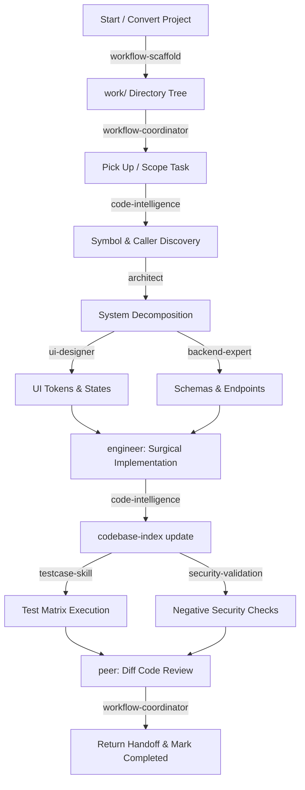

# Token-Lean Full-Stack AI Skills

A high-density, low-token AI skills suite for full-stack software development, offline code intelligence, and multi-agent workflow coordination. Designed to deliver expert-level architecture, UI/UX, backend, engineering, security, testing, and call-graph code intelligence without burning excessive tokens.

---

## Why Token-Lean? (Solving the `pstack` / `upskill` Problem)

Heavy agent frameworks and prompt stacks (like `pstack` and `upskill`) frequently blow through context windows because they:
1. **Dump monolithic system prompts** with verbose conversational preambles and meta-explanations.
2. **Eagerly load giant reference manuals and source files** regardless of the specific task.
3. **Encourage multi-page ceremonial outputs** instead of actionable code diffs and decisions.

This suite solves that through **Progressive Disclosure & Zero-Fluff Directives**:
- **Tiny Discovery Footprint**: Frontmatter descriptions are kept under 25 words (~250 tokens total for the entire 11-skill suite).
- **Dense Imperative Instructions**: Each `SKILL.md` is strictly 200–350 words, focusing purely on decisions, constraints, and deliverables.
- **Reference Sharding**: Deep domain checklists (e.g., API security specs, retrieval patterns) live in standalone reference files loaded only when that domain is actively engaged.
- **Strict Output Budgets**: Standardized compact formats (ADRs, component trees, DDL schemas, diffs, test matrices) minimize generation tokens.

---

## Full-Stack, Workflow & Intelligence Skills

| Skill | Role | Key Deliverables & Responsibilities |
| :--- | :--- | :--- |
| **[`code-intelligence`](./code-intelligence/SKILL.md)** | Codebase Intelligence | Persistent, offline AST symbol extraction, callers/refs lookup, blast-radius impact analysis via `codebase-index`. |
| **[`workflow-scaffold`](./workflow-scaffold/SKILL.md)** | Workflow Bootstrapper | Scaffolds the `work/` directory tree or migrates legacy TODO backlogs into structured work packages. |
| **[`workflow-coordinator`](./workflow-coordinator/SKILL.md)** | Workflow & Handoffs | Manages task pickup, subtask contracts, multi-agent handoffs, and status tracking using `work/`. |
| **[`architect`](./architect/SKILL.md)** | System Architect | System design selection & justification (explaining WHY), modular directory blueprints, ADRs, subtask dependencies. |
| **[`ui-designer`](./ui-designer/SKILL.md)** | UI/UX & Frontend | Design tokens, layout hierarchy, states (loading/empty/error), a11y, component tree. |
| **[`backend-expert`](./backend-expert/SKILL.md)** | Backend & Database | Layered architecture (controller/service/repo), typed config/12-factor, schemas, ACID transactions, API contracts. |
| **[`engineer`](./engineer/SKILL.md)** | Full-Stack Implementation | Anti-monolith modular code, zero-hardcoding (YAML/env vars), code reuse/DRY patterns, surgical diffs. |
| **[`testcase-skill`](./testcase-skill/SKILL.md)** | Test Engineer | Compact traceable test matrices (happy path, boundary, failure, security). |
| **[`security-validation`](./security-validation/SKILL.md)** | Security Expert | Threat modeling, OWASP triage, authz/IDOR checks, mandatory negative tests. |
| **[`peer`](./peer/SKILL.md)** | Peer Reviewer | Diff-first code review, catches monolith bloat, hardcoded values, code duplication, and regressions. |
| **[`skill-feedback`](./skill-feedback/SKILL.md)** | Skill Refinement | Evidence-based skill improvements, applied only with explicit user approval. |

---

## Code Intelligence (`codebase-index` Integration)

The repository integrates persistent, local code intelligence via [`denfry/codebase-index`](https://github.com/denfry/codebase-index) to enable **index-first navigation**:

```
TASK RECEIVED
     │
     ▼
codebase-index symbol / search / refs
     │
     ▼
Inspect Bounded Lines Only (e.g. L45-L70)
     │
     ▼
Make Surgical Edits
     │
     ▼
codebase-index update (Incremental Refresh)
```

### 1. Installation
Install the pinned version in your Python environment:
```bash
pip install codebase-index==2.1.2
```

### 2. Helper Script & Health Check
A deterministic utility script is included in `scripts/codebase_index_helper.py`:
```bash
# Check status and index existence
python3 scripts/codebase_index_helper.py status

# Verify strictly offline / zero-remote embedding guarantees
python3 scripts/codebase_index_helper.py check-offline

# Initialize or incrementally update index
python3 scripts/codebase_index_helper.py ensure-index
```

### 3. Key CLI Commands
- `codebase-index symbol <Name>`: Find exact declaration file, lines, and signature.
- `codebase-index refs <Name> --compact`: Find all call sites and callers.
- `codebase-index impact <Target> --compact`: Upstream/downstream graph blast-radius walk.
- `codebase-index diff-impact`: Predict blast radius of current Git diff.
- `codebase-index search "<query>" --compact --token-budget 1200`: Bounded hybrid search.
- `codebase-index update`: Incremental update (mtime/git aware, fast).

### 4. Zero Network & Zero Token Guarantee
- Operates using native **Tree-sitter** AST parsers and a local **SQLite FTS5** database (`.claude/cache/codebase-index/index.sqlite`).
- Embeddings backend is set to `"noop"` (`enabled=False`, `allow_external=False`). Zero network calls, zero external API keys, zero LLM tokens burned for indexing.
- SQLite caches are automatically excluded from Git via `.gitignore`.

### 5. Benchmark Performance
Comparing traditional full-file scans vs index-assisted retrieval (`scripts/benchmark_retrieval.py`):
- **Context Token Reduction**: **~94.2% fewer tokens** ingested by the agent.
- **Lines Inspected**: **~92.6% reduction** (retrieves 26 targeted lines instead of 400+ lines across 39 files).
- Run benchmark: `python3 scripts/benchmark_retrieval.py`.

### 6. Fallback & Disabling
- If `codebase-index` is not installed or fails, agents seamlessly fall back to `grep_search` and targeted line reads.
- To reset or clean the index cache:
  ```bash
  codebase-index clean
  ```

---

## The `work/` Tree Architecture

The workflow pattern (modeled after `crochet/work`) enforces modular, low-token context boundaries:

```
work/
├── INDEX.md                     # Global router / Active work index (< 50 lines)
├── TASK_TEMPLATE.md             # Subtask contract template with tests & security
└── work-NNN-<slug>/             # Scoped work package
    ├── README.md                # Objective, current state, architecture, done-when
    ├── coordination.md          # Active owner, current handoff status, return protocol
    ├── tasks.md                 # In Progress, Pending, Completed task lists
    ├── decisions.md             # Architecture Decision Records (ADRs)
    ├── notes.md                 # Evidence, verification outputs, environment notes
    └── tasks/                   # Atomic, pickup-ready subtask contracts
        ├── task-001-<slug>.md
        └── ...
```

---

## Recommended Full-Stack Lifecycle Flow



---

## Installation & Sync

### For Google Antigravity
Copy or symlink skills into your project workspace or global agent directory:
```bash
# Workspace level (project-specific)
mkdir -p .agents/skills
cp -r * .agents/skills/

# Or global level
mkdir -p ~/.gemini/antigravity/skills
cp -r * ~/.gemini/antigravity/skills/
```

### For Codex
```bash
mkdir -p ~/.codex/skills
cp -r * ~/.codex/skills/
```
